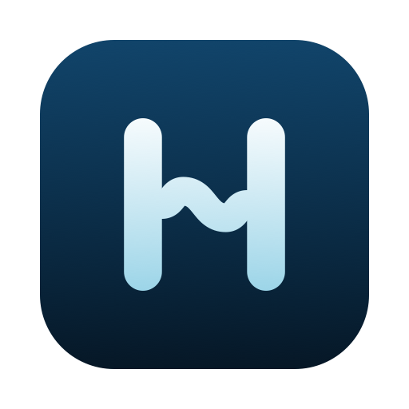

<p align="center">
  
</p>

<h1 align="center">Harbor</h1>

<p align="center">A calm, sidebar-first browser for macOS, written in Swift on WebKit.</p>

<p align="center">
  <a href="LICENSE"></a>
  
  
</p>

---

Harbor keeps your tabs in one sidebar and gives every space its own color and its own logins. It is a native AppKit and SwiftUI app on the system WebKit, so it starts fast, scrolls like Safari and stays light on battery.

## Features

**Sidebar**
- Favorites grid, pinned tabs and vertical tabs in one sidebar, with folders and drag and drop.
- Tabs opened from a page nest under it as a trail, and Back on a trail returns to its parent.
- The address bar lives in the top bar or the sidebar (⌥⌘T switches), and the sidebar hides with ⌘S.

**Spaces**
- Each space has its own color and its own cookies, logins and history.
- Two-finger swipe across the sidebar to change space.
- Air Traffic Control sends chosen sites to the space you want them in.

**Browsing**
- Command palette for tabs, history and search.
- Peek previews a link in a card over the page, and split view shows two tabs side by side.
- Picture in Picture, in the sidebar or a floating player.
- Chrome Web Store and Safari web extensions through WebKit's native extension support.
- Import from Safari, Arc and Dia.

**Privacy and speed**
- Built-in ad and tracker blocking, on by default, using adblock-rust and uBlock Origin's scriptlets.
- SponsorBlock for YouTube, plus per-site tweaks for YouTube, Facebook, Reddit and X.
- Idle tabs unload, and pages give memory back under pressure.

**Developer tools**
- Docked Web Inspector (⌥⌘I), an element picker, and console, network, blocker and performance panels.
- An optional local MCP server lets a coding agent drive the browser. It is off unless you turn it on in Settings > Developer.

## Requirements

- macOS 26 (Tahoe) or later on Apple Silicon
- Xcode 26 or later, with the Metal Toolchain: `xcodebuild -downloadComponent MetalToolchain`
- Rust, only to rebuild the ad-blocking library in `Harbor/ThirdParty/AdblockRustFFI`

## Build

Open the project, set your team under **Signing & Capabilities**, and run:

```bash
open Harbor.xcodeproj
```

To check that it compiles without a signing team:

```bash
xcodebuild -scheme Harbor -configuration Debug -arch arm64 -derivedDataPath build \
  CODE_SIGN_IDENTITY="-" CODE_SIGNING_REQUIRED=NO CODE_SIGNING_ALLOWED=NO
```

An unsigned build compiles but will not launch as a normal app. For a signed Release build you can install, see [Signing a local build](CLAUDE.md#build--run).

There is no test target. Pure logic is checked by small standalone programs under each package's `Checks/` folder and `scripts/tests/`, run with `swiftc <source> <check> -o /tmp/check && /tmp/check`. `HarborTabsCore` has a regular `swift test` suite.

## Project layout

| Path | What lives there |
|------|------------------|
| `App/` | Entry point, app delegate, windows and menus |
| `Harbor/` | Feature managers, views, WebKit glue and third-party code |
| `Navigation/` | The sidebar's structure: header, spaces pager and bottom bar |
| `CommandPalette/`, `Onboarding/`, `UI/` | The command palette, first-run flow and shared controls |
| `Packages/` | Seven local Swift packages: the tab model, settings, design tokens, ad blocker, site tweaks, web layer and shared UI |
| `HarboriOS/` | Early groundwork for an iOS companion, not shipped |
| `scripts/` | Filter-list refresh, scriptlet and redirect generators, and checks |

[docs/architecture.md](docs/architecture.md) explains how these fit together. [docs/adblocker-architecture.md](docs/adblocker-architecture.md) covers the content blocker in depth.

## Contributing

Bug reports, ideas and pull requests are welcome. Read [CONTRIBUTING.md](CONTRIBUTING.md) first, including the AI assistance notice, and follow the [code of conduct](CODE_OF_CONDUCT.md).

## License

Harbor is free software under the [GNU General Public License v3.0](LICENSE). See [NOTICE](NOTICE) for copyright and third-party notices.
